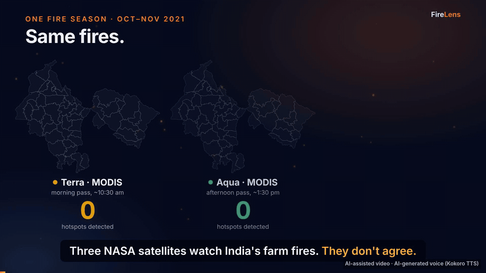
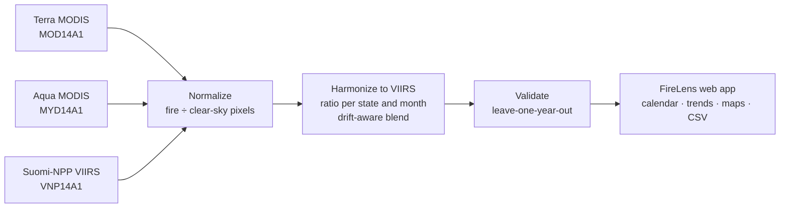
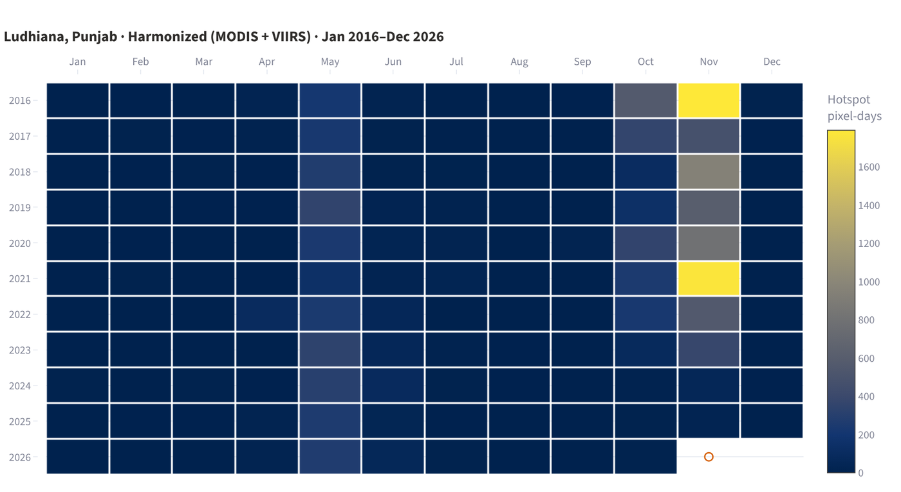
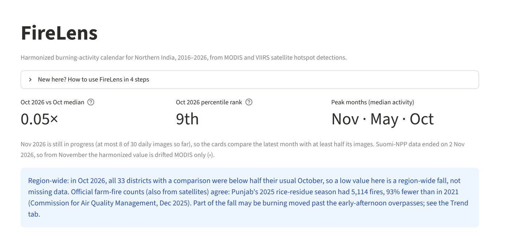
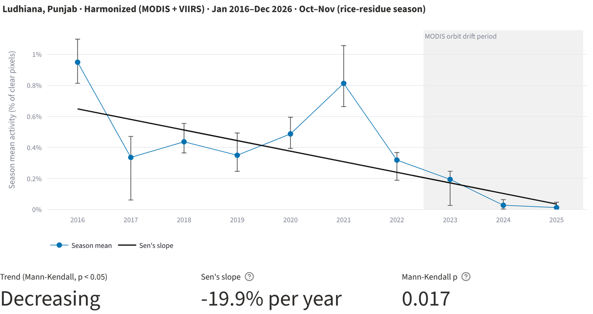
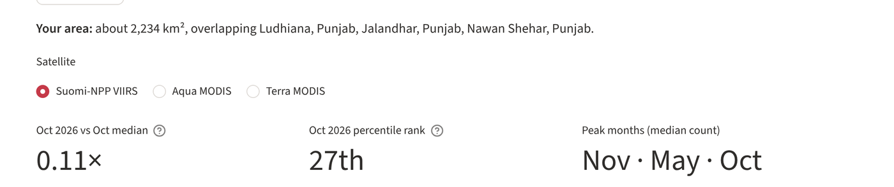
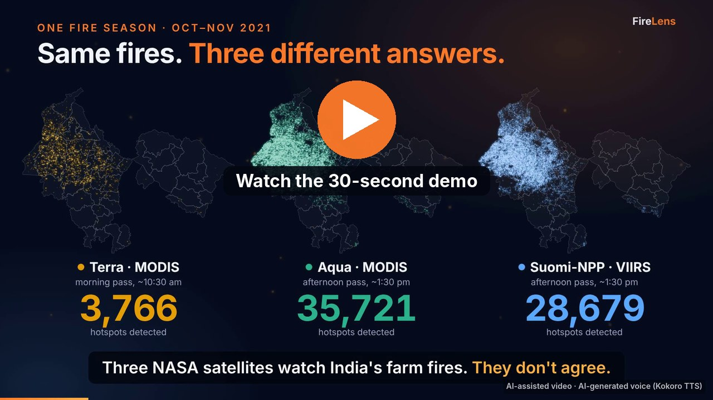

<div align="center">

# 🔥 FireLens

### One fair fire calendar from three NASA satellites

**Harmonized MODIS + VIIRS burning activity for 49 districts of Punjab, Haryana and Uttarakhand, 2016–2026**

[](https://harmonization-space-app-alvgdbyul5te9zfje6c3fz.streamlit.app/)
[](https://youtu.be/U_RdfcaZ-PA)




</div>

---

## The problem

Three NASA satellites watch the same crop fires in North India, and they **don't agree**.
Over the same Oct–Nov 2021 rice-straw burning season, in the same 49 districts:

| Satellite | Overpass | Hotspots detected |
|---|---|---:|
| Terra · MODIS | ~10:30 am | **3,766** |
| Aqua · MODIS | ~1:30 pm | **35,721** |
| Suomi-NPP · VIIRS | ~1:30 pm | **28,679** |

Terra's morning pass misses most afternoon burning, clouds hide whole monsoon months, and since 2022–23 both MODIS orbits have drifted. Put raw counts together and "burning" changes whenever the satellite changes.

## The fix

FireLens turns the three records into **one consistent monthly calendar**:

1. **Collect:** daily 1 km fire products in Google Earth Engine. For every district, month and sensor we count fire pixels and clearly seen land pixels.
2. **Normalize:** activity = fire pixels ÷ clearly seen pixels, so a cloudy month is not mistaken for a fire-free one. A month with no usable images is blank, never zero.
3. **Harmonize:** Suomi-NPP VIIRS is the anchor. Terra and Aqua are scaled to it with one ratio per state and calendar month, then blended with VIIRS, weighted by how well each predicted VIIRS in years it never saw. MODIS is used only from before its orbit drift.
4. **Validate:** blind leave-one-year-out tests on 2016–2022.

| Validation (leave-one-year-out vs VIIRS) | Result |
|---|---|
| Scaled Terra MODIS | **r = 0.91**, peak-season total within 4% |
| Scaled Aqua MODIS | **r = 0.98**, peak-season total within 4% |
| MODIS alone rebuilding the VIIRS record | **r = 0.97**, bias 2% |



## What you can do in the app

| | |
|---|---|
|  | **Fire calendar.** Month × year heatmap for any district: Oct–Nov rice straw and Apr–May wheat stubble stand out at a glance. Harmonized by default, or any single satellite. |
|  | **Is this month unusual?** The latest month against its own history (ratio to median, percentile rank), with region-wide context and the official CAQM count. |
|  | **Trends you can trust.** Mann-Kendall test and Sen's slope per district and as a map, with the MODIS-drift years marked. |
|  | **Draw your own area.** Any box or polygon gets its own calendar, trend and hotspot list, from each satellite. |

Also: a sensor comparison (as recorded vs harmonized), the sensor range behind every value, fire type (cropland, forest, woodland) and static heat sources, a MODIS-only check, and downloads: monthly CSVs, **619,188** individual hotspots, or everything in one ZIP with a data dictionary and citation. Every chart exports as PNG.

## What it shows

Detected rice-season (Oct–Nov) hotspots across the 49 districts fell **96%** from 2021 to 2025 (Suomi-NPP: 28,679 → 1,111). That agrees with the official Commission for Air Quality Management count for Punjab (−93%). Aqua, which now passes later in the afternoon, still sees more, so part of the fall may be burning that moved past the overpass time. FireLens flags this instead of hiding it.

## Watch the demo

<a href="https://youtu.be/U_RdfcaZ-PA"></a>

## Run it yourself

```bash
git clone https://github.com/frbasil-1k/HARMONIZATION-space-app.git
cd HARMONIZATION-space-app/firelens
python -m venv .venv && source .venv/bin/activate   # Windows: .venv\Scripts\activate
pip install -r app/requirements.txt
streamlit run app/app.py                            # opens http://localhost:8501
```

The data is in the repo, so there is nothing else to set up. Tests: `python -m pytest tests -q` (135 tests; GitHub Actions also runs them on every pull request).

## Repository map

```
firelens/
├── app/          Streamlit web app
├── gee/          Google Earth Engine export scripts
├── science/      quality checks, harmonization, validation (validation.md)
├── data/         the tables the app reads + data dictionary
├── docs/         decisions log and data contract
├── submission/   project page text and storyboard
└── tests/        pytest suite
```

Full method, limitations and next steps: **[firelens/README.md](firelens/README.md)** · Validation details: **[firelens/science/validation.md](firelens/science/validation.md)**

## Data

| Data | Product | Source |
|---|---|---|
| MODIS Terra Thermal Anomalies & Fire Daily, 1 km | [MOD14A1 v6.1](https://developers.google.com/earth-engine/datasets/catalog/MODIS_061_MOD14A1) | NASA LP DAAC, via Google Earth Engine |
| MODIS Aqua Thermal Anomalies & Fire Daily, 1 km | [MYD14A1 v6.1](https://developers.google.com/earth-engine/datasets/catalog/MODIS_061_MYD14A1) | NASA LP DAAC, via Google Earth Engine |
| VIIRS Suomi-NPP Thermal Anomalies & Fire Daily, 1 km | [VNP14A1 v2](https://developers.google.com/earth-engine/datasets/catalog/NASA_VIIRS_002_VNP14A1) | NASA LP DAAC, via Google Earth Engine |
| District boundaries | [GAUL Level 2 (2015)](https://developers.google.com/earth-engine/datasets/catalog/FAO_GAUL_2015_level2) | FAO, via Google Earth Engine |

We acknowledge the use of data from NASA's Land Processes Distributed Active Archive Center (LP DAAC), part of NASA's Earth Science Data and Information System (ESDIS).

**Limitations, in short:** values are detections of 1 km pixels, not counts of individual fires; GAUL boundaries are not official boundaries of India; Suomi-NPP delivery ended in November 2026, so adding NOAA-20/21 VIIRS is the next step. See [firelens/README.md](firelens/README.md#limitations).

## Team COSMICBRO's

| Role | Name |
|---|---|
| Data & Earth Engine | Lincoln Serrao |
| Science lead | Shaikh Mohammed Basil |
| App | Mohammed Mubeen Kamalsha |
| Product & pitch | Mohammed Zaidan Contractor |

Built for the **NASA Space Apps Challenge 2026**.

## Use of AI

We used Claude (Anthropic) as a coding and writing assistant for parts of the pipeline, app, tests, documentation and the demo video (built with Remotion). The team checked all science choices and results, and everything is reproducible from this repository. The demo video's voiceover is AI-generated with Kokoro TTS (open source), and the video says so on screen. Charts, maps and numbers are drawn by code from the NASA data.

## Cite and license

Cite with the **"Cite this repository"** button (from [CITATION.cff](CITATION.cff)), and cite the NASA products above.
Code: [MIT](LICENSE). Derived data tables: CC BY 4.0. District boundaries stay under FAO's GAUL licence.
